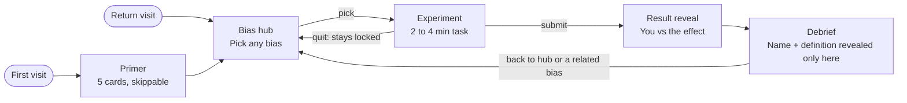

# Behavioural Science Playground — Product Spec

Oct 17, 2026

## Summary

The Behavioural Science Playground is a web app where people learn cognitive biases by experiencing them first, then getting the explanation. Each bias is a 2–4 minute interactive experiment; the definition is revealed only after the user has completed it, so the "aha" comes from their own behaviour rather than a textbook.

**Problem.** Most bias content is a list of definitions. Readers nod along but rarely notice the bias in themselves, so the learning doesn't stick.

**Goals**

- Give a newcomer enough context in under 5 minutes to understand what behavioural science is and why biases matter.
- Let users choose which bias to explore first, with no forced linear path.
- Make every bias felt before it is explained: experiment first, debrief second.
- Leave users able to define each bias they completed and recognise it in a real-world example.

**Non-goals (v1)**

- Clinical or diagnostic assessment of an individual's thinking.
- Research-grade data collection or publishing results as scientific findings.
- User accounts, social features or a full course/certification path.

## Users and learning objectives

The primary user is a curious non-specialist; the design must work with zero prior knowledge.

| User | Context | What they need |
| --- | --- | --- |
| Curious learner | Heard of "nudges" or *Thinking, Fast and Slow*; browsing for fun | Quick, playful, no jargon |
| Student | Psychology, economics or marketing course | Accurate definitions, key studies, citations |
| Practitioner | Product, policy, UX or marketing professional | Real-world applications and design implications |
| Educator | Running a workshop or class | Experiments that work live with a group |

**Learning objectives.** After completing a bias module, the user can:

1. Describe what happened to them in the experiment.
2. Define the bias in one sentence, in their own words.
3. Explain the mechanism (why the mind does this).
4. Recognise it in at least one real-world scenario.
5. Name one strategy to reduce or design around it.

## User journey

First-time users get the primer, then choose freely from the hub; every bias loop ends in a debrief that sends them back to the hub.

Returning users land on the hub. Quitting an experiment returns to the hub without unlocking the debrief.

**Screens:** Primer · Bias hub · Experiment (intro + task) · Result reveal · Debrief · Settings (show bias names, extend time, reset progress).

## Feature 1: Behavioural science primer

The primer gives first-time users the minimum context to make the experiments meaningful, in 3–5 minutes of reading or swiping.

**Content (5 short cards)**

1. **What is behavioural science?** The study of how people actually make decisions, drawing on psychology and economics, versus the "rational agent" assumption.
2. **Two systems of thinking.** Fast, automatic, intuitive thinking (System 1) versus slow, effortful, deliberate thinking (System 2).
3. **Heuristics.** Mental shortcuts that are usually helpful and make everyday decisions possible.
4. **Biases.** Systematic, predictable errors that occur when heuristics misfire. Everyone has them; intelligence doesn't protect you.
5. **How the playground works.** "You'll try an experiment first. Answer honestly and quickly. We'll explain what happened afterwards." Includes a note that responses are anonymous.

**Requirements**

- P1-1: Shown automatically on first visit; skippable at any time via a visible "Skip to experiments" link.
- P1-2: Always reachable later from the main navigation ("About biases").
- P1-3: Each card holds at most ~80 words plus one illustration or animation.
- P1-4: Must not name or define any specific bias that appears in an experiment, to avoid priming users.
- P1-5: Ends with a single call to action: "Choose your first bias", leading to the hub.

**Acceptance criteria**

- [ ] A first-time visitor sees the primer before the hub.
- [ ] A returning visitor lands directly on the hub.
- [ ] Skipping from any card lands on the hub.
- [ ] Median completion time in testing is 5 minutes or less.

## Feature 2: Bias navigation hub

The hub is the home screen: a grid of bias cards that lets users start with whichever bias interests them, in any order.

**Card contents (before completion)** — to preserve the surprise, a locked-in card shows a *teaser*, not the definition:

- Playful experiment title (e.g. "Guess the number" rather than "Anchoring")
- One-line hook (e.g. "How good are your estimates?")
- Estimated time (2–4 min) and category tag

**Card contents (after completion)** — the card reveals the bias name, a one-line definition, a "Completed" mark and a "Revisit debrief" link.

**Organisation**

- Categories: *Judgement & estimation*, *Choices & framing*, *Memory & perception*, *Social influence*, *Self & time*.
- Filter by category; sort by "Recommended for beginners" (default) or alphabetical.
- A "Surprise me" button picks a random uncompleted bias.
- Progress indicator: "3 of 10 biases explored".

**Requirements**

- P2-1: Any bias can be started from the hub without completing others first.
- P2-2: Progress persists across visits on the same device without requiring sign-in (local storage).
- P2-3: Bias names stay hidden on uncompleted cards by default; a settings toggle "Show bias names" exists for educators and students revising.
- P2-4: Layout works from 320px phone width to desktop; cards are fully keyboard-navigable.
- P2-5: Users can reset progress.

**Acceptance criteria**

- [ ] Every launch bias appears on the hub and can be launched in one tap/click.
- [ ] Completing an experiment updates its card and the progress count immediately.
- [ ] Filters and "Surprise me" never return a bias outside the selected category or an already-completed one (unless all are completed).

## Feature 3: Interactive experiments and debrief

Every bias module follows the same four-stage pattern, and the definition is never shown until the user has finished the experiment.

**Module anatomy**

1. **Intro (10 sec).** One neutral sentence of instructions that does not hint at the bias, e.g. "Answer quickly — go with your gut."
2. **Experiment (1–3 min).** A short interactive task: estimate, choose, recall, sort, slide, or react under time pressure. Where the effect needs a comparison, the user is randomly assigned to one condition (e.g. high vs low anchor).
3. **Result reveal (30 sec).** Shows what the user did, compared with what the bias predicts and, where available, how other users or original study participants responded ("You estimated 62%. People shown a higher number guessed 20 points higher on average.").
4. **Debrief (1–2 min).** The explanation, structured below.

**Debrief structure (fixed for every bias)**

- **Name** of the bias
- **Definition** — one plain-language sentence
- **What just happened** — links the user's own result to the bias
- **Why it happens** — the mechanism / heuristic behind it
- **Classic study** — one landmark study with authors, year and citation
- **In the real world** — 2–3 examples (shopping, work, health, policy)
- **How to counter it** — 1–2 practical debiasing tips, plus how designers use or mitigate it
- **Check your understanding** — one optional multiple-choice question
- **Next** — "Back to hub" and a suggested related bias

**Requirements**

- P3-1: The definition, bias name and explanation are only shown after the experiment is submitted. The URL, page title and page source must not leak the bias name during the experiment.
- P3-2: Every experiment can be completed in 4 minutes or less.
- P3-3: Instructions must be honest. No experiment may deceive the user about anything beyond withholding the bias name until the debrief.
- P3-4: If a user's own result didn't show the bias, the debrief says so without judgement ("You resisted it this time — most people don't") and still explains the effect using aggregate data.
- P3-5: Users can quit mid-experiment and return to the hub; an incomplete experiment does not count as completed and its debrief stays locked.
- P3-6: All debrief content is reviewed for accuracy by someone with a behavioural science background; every classic study carries a citation.

**Acceptance criteria**

- [ ] No screen before submission displays the bias name or definition.
- [ ] The debrief always renders all mandatory fields (name, definition, what happened, why, study, examples, counter-strategy).
- [ ] The "What just happened" text reflects the user's actual answers.
- [ ] Randomised conditions split roughly 50/50 across users.

## Launch bias catalogue

V1 launches with 10 biases spread across the five hub categories, chosen because each produces a reliable effect in a short solo experiment.

| Bias | Category | Experiment (what the user does) | Debrief hook | Classic study |
| --- | --- | --- | --- | --- |
| Anchoring | Judgement & estimation | Spins a "random" wheel (rigged high or low), then estimates a quantity, e.g. % of UN countries in Africa | Your estimate drifted toward an irrelevant number | Tversky & Kahneman, 1974 |
| Availability heuristic | Judgement & estimation | Judges which of two causes of death is more common (e.g. shark attacks vs falling objects) | Vivid, memorable events feel more frequent | Tversky & Kahneman, 1973 |
| Overconfidence | Judgement & estimation | Gives 90% confidence ranges for 10 trivia quantities | Fewer than 9 of 10 ranges contain the answer | Alpert & Raiffa, 1982 |
| Framing effect | Choices & framing | Chooses a disease-response programme described as "lives saved" or "lives lost" (randomised) | Same outcomes, different choices | Tversky & Kahneman, 1981 |
| Decoy effect | Choices & framing | Picks a subscription plan from a menu with or without an inferior "decoy" option | The decoy steers you to the target plan | Huber, Payne & Puto, 1982 |
| Sunk cost fallacy | Choices & framing | Decides whether to keep going with a paid-for but now unappealing trip/project | Past costs shouldn't drive future choices | Arkes & Blumer, 1985 |
| Confirmation bias | Memory & perception | Wason 2-4-6 task: tests number triples to discover a hidden rule | You tested to confirm, not to disprove | Wason, 1960 |
| Misinformation effect | Memory & perception | Watches a short animated clip, then answers questions with "smashed" vs "hit" wording | Question wording reshaped your memory | Loftus & Palmer, 1974 |
| Social proof / conformity | Social influence | Answers easy line-length judgements after seeing simulated "previous answers" | Others' answers pulled on yours | Asch, 1951 |
| Present bias | Self & time | Chooses between smaller-sooner and larger-later rewards at two time horizons | Preferences flip when "now" is involved | Thaler, 1981 |

Study references are from general knowledge and must be checked against original sources during content review (P3-6).

**Candidates for v2:** endowment effect, loss aversion, gambler's fallacy, planning fallacy, halo effect, hindsight bias, choice overload, default effect.

## Content model

Each bias is one self-contained content record, so new biases can be added without code changes beyond any new experiment component.

| Field | Type | Notes |
| --- | --- | --- |
| id | string | Opaque slug, e.g. `exp-07`; must not contain the bias name (P3-1) |
| teaserTitle / teaserHook | string | Shown on the hub before completion |
| category | enum | One of the five hub categories |
| estMinutes | number | 2–4 |
| experimentType | enum | estimate, choice, recall, sort, slider, timed-response |
| conditions | list | Variants for random assignment (e.g. highAnchor, lowAnchor); empty if none |
| experimentConfig | object | Questions, stimuli, options, correct answers |
| resultLogic | object | How to compute and describe the user's result vs the predicted effect |
| biasName / definition | string | Revealed only in the debrief |
| whyItHappens | markdown | Mechanism |
| classicStudy | object | Authors, year, one-line summary, citation URL |
| realWorldExamples | list | 2–3 items |
| counterStrategies | list | 1–2 items |
| quiz | object | Optional question, options, answer, explanation |
| relatedBiasIds | list | Powers the "Next" suggestion |

**Stored per user (local, anonymous):** completed bias ids, assigned condition per bias, raw answers, completion timestamp.

## UX, accessibility, privacy and ethics

The playground should feel like a game but behave like a responsible research-literate product.

**UX and tone**

- Curious and non-judgemental: biases are framed as normal features of every brain, never as user failures.
- One task per screen; no scrolling during an experiment.
- Plain language at roughly a 12-year-old reading level; jargon only in the debrief, always defined.

**Accessibility (WCAG 2.2 AA)**

- Full keyboard and screen-reader support, including for sliders and drag-to-sort tasks (provide button alternatives).
- Timed experiments offer an "extend time" setting; timing is never the only way to complete a module.
- No meaning conveyed by colour alone; respects reduced-motion preferences.

**Privacy**

- No sign-in and no personal data in v1; progress lives in local storage.
- Any aggregate statistics use anonymous, opt-in responses only, with a plain-language notice in the primer.

**Ethics**

- Withholding the bias name is the only concealment allowed; no deceptive feedback about the user's performance.
- Avoid sensitive stimuli (e.g. real tragedies, health conditions of individuals); the framing-effect scenario uses a hypothetical.
- Each debrief links to further reading so users can verify claims.

## Success metrics

Success means users finish experiments, understand the bias, and come back for more. Targets below are proposed starting points to revisit after launch.

| Metric | Definition | Proposed v1 target |
| --- | --- | --- |
| Experiment completion rate | Experiments finished / experiments started | ≥ 75% |
| Debrief read-through | Debriefs scrolled to "How to counter it" / debriefs opened | ≥ 60% |
| Comprehension | Correct answers on the optional quiz | ≥ 70% |
| Biases per session | Median biases completed per visit | ≥ 2 |
| Return rate | Users returning within 14 days | ≥ 20% |
| Effect replication | Share of experiments where aggregate data shows the expected effect direction | 10 of 10 biases |

## Open questions and roadmap

**Open questions**

- [ ] Platform: responsive web app only, or also native mobile?
- [ ] Should aggregate "how others answered" data come from live users, published studies, or both at launch?
- [ ] Who reviews debrief content for scientific accuracy, and how often?
- [ ] Is an educator/classroom mode (shared session, live group results) in scope for v1 or v2?
- [ ] Target languages beyond English?

**Roadmap (proposed)**

1. **v1** — primer, hub, 10 bias modules, local progress.
2. **v1.5** — anonymous aggregate results shown in debriefs; 8 more biases.
3. **v2** — optional accounts, classroom mode, "spot the bias" real-world scenario challenges, shareable result cards.
